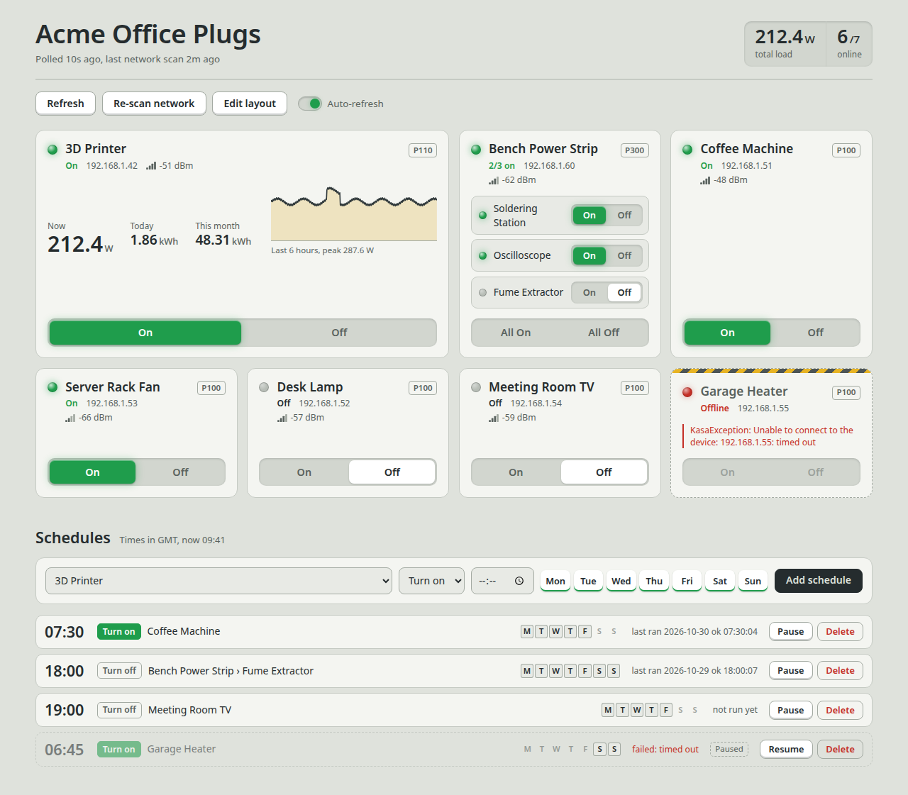

# tapo-dash

A small self-hosted web dashboard for TP-Link Tapo smart plugs and power
strips on your LAN. It finds the plugs by itself, shows whether each one is on, switches
them, and graphs power for plugs with energy monitoring. It runs as a single
Docker container with no cloud service or database server.

Built on [python-kasa](https://github.com/python-kasa/python-kasa). Tested with
the **P100**, **P110** (energy monitoring) and **P300** (3-socket strip); other
Tapo plugs supported by python-kasa should work.

<picture>
  <source media="(prefers-color-scheme: dark)" srcset="docs/screenshot-dark.png">
  
</picture>

<sub>Demo data. Plug names and addresses are illustrative.</sub>

## Features

- Discovers plugs by UDP broadcast (several rounds, since a single round is
  lossy), with an optional unicast sweep of a CIDR for plugs that never answer
  broadcast.
- Polls every device in a **background task** and serves a cached snapshot, so
  page loads are instant rather than triggering a fresh scan.
- Keys devices by **MAC**, not IP, so a DHCP lease change doesn't break links,
  history, or the on/off buttons.
- Records power readings for energy-capable plugs (P110) to SQLite and draws a
  6-hour sparkline. Rows older than `HISTORY_DAYS` are pruned.
- Power strips (P300) get a row per socket with its own on/off; the strip-level
  buttons switch every socket.
- Shows offline devices as offline instead of silently dropping them, and
  forgets them once they have missed discovery for `STALE_AFTER` seconds.
- **Schedules**: switch any plug, a whole strip, or a single strip socket on or
  off at a time of day on chosen weekdays. Rules run inside the dashboard, so
  they fire whether or not anyone has the page open.
- **Edit layout**: rename plugs and sockets and drag cards into your own order.
  Names set here override the plug's own, which helps for a P300 (the Tapo app
  only names its sockets) and for plugs paired to another account.
- **Hide offline** toggle to declutter the grid; remembered per browser, with
  a note saying how many plugs are hidden.
- Optional view-only mode (`ALLOW_CONTROL=false`).

## Quick start

Requires Docker with the Compose plugin, on a Linux host in the same broadcast
domain as the plugs.

```sh
git clone https://github.com/gordon-n-stevenson/tapo-dash.git
cd tapo-dash
cp tapo.env.example tapo.env
chmod 600 tapo.env
$EDITOR tapo.env            # Tapo account email/password, and TZ for schedules
docker compose up -d --build
```

Then open `http://<host>:8080/`.

The container uses **host networking**: Tapo discovery relies on UDP broadcast,
which does not cross Docker's bridge NAT. This also means it needs a Linux
Docker host; Docker Desktop on macOS/Windows will not see the plugs.

### Credentials

Plugs authenticate local connections with the Tapo **cloud account** they are
paired to, so put that account's email and password in `tapo.env`. Plugs
paired to a different account show "credentials rejected".

Newer firmware may also need **Third-Party Compatibility** enabled in the Tapo
app (Me → Tapo Lab → Third-Party Compatibility). If the cloud password alone is
rejected, set `TAPO_LOCAL_USERNAME` / `TAPO_LOCAL_PASSWORD`.

`tapo.env` is git-ignored and never baked into the image.

## Configuration

| Variable | Default | Notes |
|---|---|---|
| `TAPO_EMAIL` / `TAPO_PASSWORD` | — | Tapo cloud account |
| `TAPO_LOCAL_USERNAME` / `TAPO_LOCAL_PASSWORD` | falls back to cloud | For firmware requiring Third-Party Compatibility |
| `DASHBOARD_TITLE` | `Tapo Plugs` | Page heading and browser tab title |
| `TZ` | `UTC` | Timezone schedules run in, e.g. `Europe/London` |
| `ALLOW_CONTROL` | `true` | Set `false` for a view-only dashboard |
| `PORT` | `8080` | Listen port (also update the compose healthcheck) |
| `POLL_INTERVAL` | `10` | Seconds between device polls |
| `REDISCOVER_INTERVAL` | `300` | Seconds between network scans |
| `DISCOVERY_ROUNDS` | `2` | Broadcast rounds per scan |
| `BROADCAST_TARGETS` | `255.255.255.255` | Comma-separated; add a directed broadcast (e.g. `192.168.2.255`) for another routed subnet |
| `SWEEP_CIDRS` | empty | e.g. `192.168.1.0/24` to unicast-probe every address |
| `STALE_AFTER` | `3600` | Seconds without a discovery reply before a device is dropped |
| `HISTORY_DAYS` | `7` | Retention for power history |
| `HISTORY_DB` | `/data/history.db` | SQLite path (on the `tapo-dash-data` volume) |

## API

- `GET /` — dashboard
- `GET /healthz` — device count, last poll, current error
- `GET /api/devices` — cached snapshot of every device
- `GET /api/devices/{mac}/history?hours=6`
- `POST /api/devices/{mac}/{on|off|toggle}` — on a strip, switches every socket
- `POST /api/devices/{mac}/children/{child_id}/{on|off|toggle}` — one strip socket
- `POST /api/rediscover` — force a network scan
- `GET /api/schedules` — all rules, plus the timezone they run in
- `POST /api/schedules` — `{"mac", "child_id"?, "action": "on|off", "at": "HH:MM", "days": "01234"}` (Monday=0; omit `child_id` for a plug or a whole strip)
- `PATCH /api/schedules/{id}` — `{"enabled": false}` to pause, `true` to resume
- `DELETE /api/schedules/{id}`
- `PUT /api/devices/{mac}/name`: `{"name", "child_id"?}` sets a dashboard name; blank or `null` reverts to the plug's own
- `PUT /api/layout`: `{"order": [mac, ...]}` sets the card order; `[]` resets it to alphabetical

`{mac}` is the plug's MAC without separators, as returned by `/api/devices`.

## Schedules

Add rules from the **Schedules** section under the plug cards. Times are in
the container's timezone, so set `TZ` in `tapo.env` (the header shows which
zone is in use). Rules are stored in the same SQLite file as the power history
and need `ALLOW_CONTROL=true`.

If a plug is unreachable when a rule is due, the dashboard keeps retrying for
10 minutes, then gives up until the rule's next day; the failure is shown next
to the rule. Rules missed while the container was down are not replayed, and a rule set
inside the hour that is skipped when daylight saving starts does not run that
day.
Schedules are not written to the plugs, so they only run while the dashboard is
running; schedules set in the Tapo app keep working independently.

## Edit layout

Press **Edit layout** to rename plugs, strips and sockets, and to reorder the
cards by dragging the handle or with the arrow keys. The on/off switches are
hidden while editing, and changes save as you go. Names and order are stored in
the dashboard's SQLite file, keyed by MAC, so they survive IP changes and apply
to everyone viewing the dashboard.

## Security

There is no authentication. Anyone who can reach the port can switch plugs.
Keep it on a trusted network, put it behind a reverse proxy with auth, or set
`ALLOW_CONTROL=false`.

## License

MIT, see [LICENSE](LICENSE).
